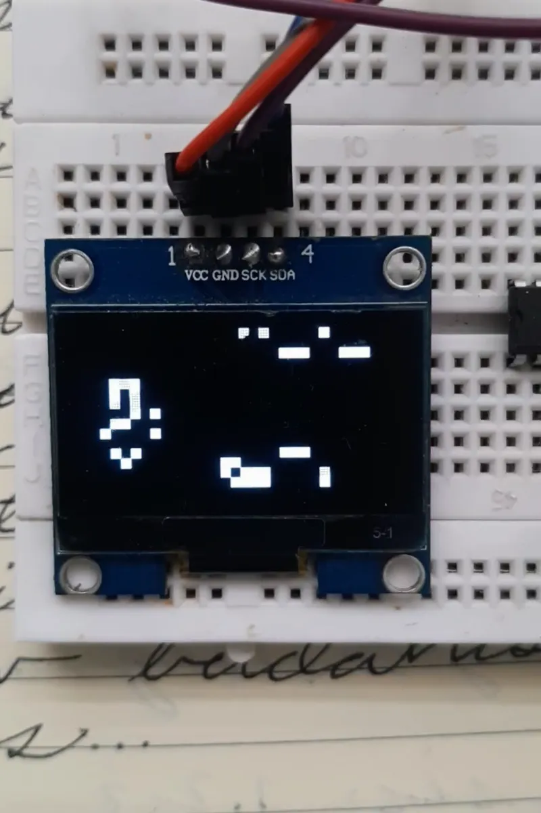
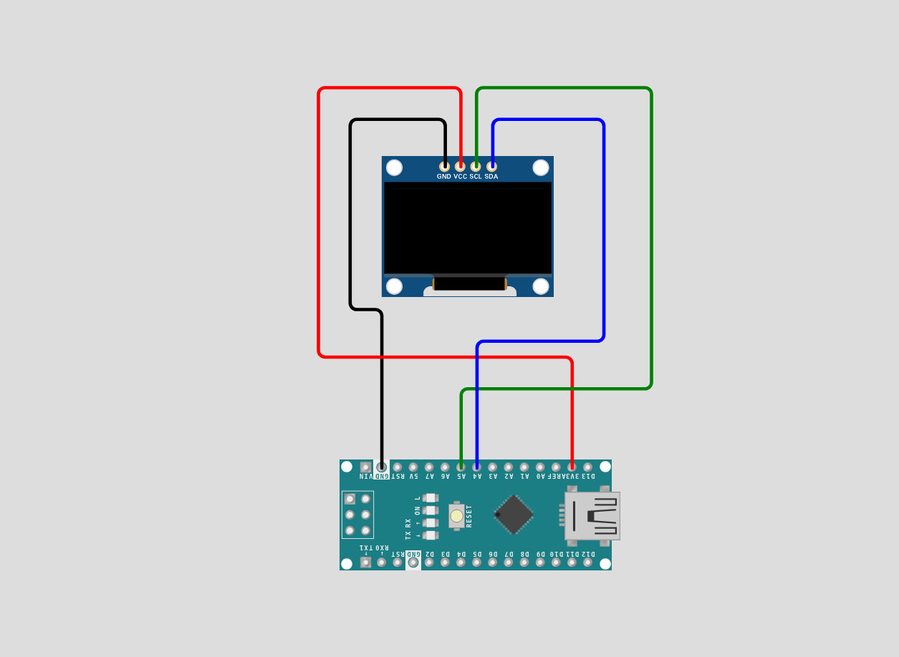

# Convays Game of Life 🐁

<p align="center">
  
</p>

<p align="center">
  
  
  
  
</p>


<p align="center">
  <a href="#overview-">Overview🦤</a> •
  <a href="#features-">Features✨</a> •
  <a href="#installation-">Installation🐧</a> •
  <a href="#hardware-">Hardware🪿</a> •
  <a href="#contribution-">Contribute🤝</a> •
  <a href="#developer-guidelines-">Developer Guidelines 🐳</a>
</p>

---

## Overview 🐢

Conway’s Game of Life is a smaller replica of the classic Conway's Game of Life. A 32×16 grid of cells evolves each generation according to four simple rules: underpopulation, survival, overpopulation, and reproduction, producing complex emergent patterns from the simplest rules. The simulation will auto-seed whenever it stagnates or dies out.

---

## Features 🦤
- **Classic Game of Life Rules** — Each cell lives or dies each generation based on its 8 neighbours, following Conway's original four rules exactly
- **Toroidal Grid** — The grid wraps around on all edges so patterns never hit a dead wall — left connects to right, top connects to bottom
- **Double Buffering** — Current and next generation are stored in separate buffers and swapped each tick, ensuring all cells update simultaneously and correctly
- **Auto-Reseed** — The simulation detects both near-death (fewer than 10 live cells) and stagnation (no change between generations) and reseeds automatically with a new random state
- **Tuned Initial Density** — Seeds at 30% alive cells rather than 50%, producing longer-lived and more varied patterns before stabilising
- **Compact & Efficient** — Fits within the ATmega328P's 2KB RAM using one byte per cell with two 32×16 bool arrays totalling 1KB, leaving headroom for stack and display buffer

---

## Installation 🐧

### Prerequisites
- **Arduino IDE 1.8.x or higher** ([Download here](https://www.arduino.cc/en/software))
- USB cable (USB-A to USB-B for Uno, or appropriate for your board)
- Git (optional, for cloning method)

---

### Method 1: Download from GitHub Release (Easiest)

#### Step 1: Download the Code
1. Visit the [Releases page](https://github.com/aydakikio/convays_game_of_life/releases)
2. Click on the latest release
3. Download the **convays_game_of_life.ino** file

#### Step 2: Install U8g2 Library
1. Open **Arduino IDE**
2. Go to **Sketch → Include Library → Manage Libraries...**
3. Search for `U8g2`
4. Install **U8g2 by olikraus**

#### Step 3: Open the Project
1. **File → Open**
2. Select `convays_game_of_life.ino`

#### Step 4: Configure Arduino
1. Connect Arduino via USB
2. **Tools → Board → Arduino Uno**
3. **Tools → Port** → Select your Arduino port

#### Step 5: Upload
1. Click **Upload** (→) or press `Ctrl+U`
2. Game starts immediately!

---

### Method 2: Clone from GitHub

```bash
# Clone repository
git clone github.com/aydakikio/convays_game_of_life.git
cd convays_game_of_life/

# Open in Arduino IDE
# File → Open → source_code/convays_game_of_life.ino
```

Then follow Steps 2-5 from Method 1.

---

## Hardware 🪿

### Required Components
- **Arduino Nano** (or compatible dev board)
- **128x64 OLED Display** (SSD1306/SH1106, I2C)
- **Breadboard and jumper wires**

### Wiring

| Component   | Arduino Pin |
|:---:|:---:|
| OLED SCL    | A5          |
| OLED SDA    | A4          |

<p align="center">
  
</p>

---
## Known Issues 🐛

- **Oscillators run forever** — Stagnation detection compares two consecutive generations and reseeds if nothing changed. This catches still lifes but not period-2 oscillators (like blinkers) which flip between two states indefinitely — the grid will never reseed on those
- **Small grid stabilises quickly** — 32×16 is close to the limit of what fits in the ATmega328P's 2KB RAM; patterns have little room to evolve before reaching a stable state, even with toroidal wrapping
- **Fixed speed** — The 100ms delay is hardcoded; there is no way to adjust simulation speed at runtime
- **Weak entropy source** — `analogRead(0)` on a floating pin usually gives varied seeds, but on some Nano clones the pin is not truly floating and may produce consistent reads, causing the same starting pattern on every power cycle; connecting a resistor to A0 improves this
- **Display flickering** — Page-buffer rendering mode (`_2_`) can cause visible scan lines on some clone OLED boards; switching to full-buffer mode (`_F_`) reduces this at the cost of 1KB of SRAM, which is tight on the Nano
- **I2C address** — If the display fails to initialise, try setting the address to `0x3D` instead of `0x3C` in the U8g2 constructor


---

## Contribution 🤝

We welcome contributions from the community. Before submitting, please review the guidelines below to ensure your contribution can be integrated smoothly.

### How to Contribute

**For Code Contributions:**
1. Clone the repository: `git clone github.com/aydakikio/convays_game_of_life.git`
2. Create a feature branch: `git checkout -b feature/descriptive-name`
3. Implement your changes following the coding standards in Developer Guidelines
4. Test thoroughly on physical hardware
5. Commit with descriptive messages: `git commit -m "Fix: Grids are too small"`
6. Push to your branch: `git push origin feature/descriptive-name`
7. Submit a Pull Request with a clear description of changes and testing performed

**Pull Request Requirements:**
- Code compiles without warnings
- Tested on actual Arduino hardware
- Follows existing code style and naming conventions
- Includes comments for complex logic
- No debug code or commented-out sections

---

### Bug Reports 🐛

When reporting bugs, provide complete technical details to enable efficient reproduction and resolution.

**Required Information:**

```markdown
## Bug Description
[Clear, concise description of the issue]

## Reproduction Steps
1. [First step]
2. [Second step]
3. [Additional steps...]

## Expected Behavior
[What should happen]

## Actual Behavior
[What actually happens]

## Hardware Configuration
- **Board:** [Arduino Nano / Uno / Mega]
- **Display Controller:** [SSD1306 / SH1106]
- **Display Resolution:** [128x64]
- **Interface:** [I2C (address: 0x3C / 0x3D)]

## Software Environment
- **Arduino IDE:** [Version number, e.g., 1.8.19 / 2.0.3]
- **U8g2 Library:** [Version, e.g., 2.34.22]
- **OS:** [Windows / macOS / Linux]

## Build Information
- **Sketch Size:** [e.g., 8,432 bytes (27%) of program storage]
- **Global Variables:** [e.g., 1,124 bytes (54%) of dynamic memory]
- **Compiler Warnings:** [Yes/No — include if present]

## Additional Context
- Simulation state when bug occurred (running / stagnated / reseeding)
- How many generations before issue appeared
- Modified code sections if any
- Intermittent or consistent occurrence
- Photographs of physical setup

## Attempted Solutions
[What you've already tried to fix the issue]
```

---

### Feature Requests

For new features, open an issue describing:
- Use case and benefit to the simulation
- Proposed implementation approach
- Memory and performance impact on the ATmega328P
- Hardware compatibility considerations

---

### Contribution Areas

**High Priority:**
- Period-2 oscillator detection for smarter reseeding
- Adjustable simulation speed at runtime via buttons
- Improved entropy source for better random seeding

**Accepted Contributions:**
- Multiple seeding patterns (random, classic glider, R-pentomino)
- Pause and step-by-step mode via buttons
- Generation counter displayed on screen
- High score (longest run) persistence via EEPROM
- Smaller cell size option for denser grids on larger displays
- Sound events via buzzer on reseed or stagnation

**Documentation:**
- Wiring diagrams and schematics
- Troubleshooting guides for common display issues
- Explanation of Game of Life rules and emergent patterns

---

## Developer Guidelines 🐳

### Code Structure
```cpp
// Hardware configuration (display, I2C pins)
// Grid configuration (#define grid_size, dimensions)
// Global state (grid buffers, cur index)
// Forward declarations
// setup() — display init, random seed, initial grid seeding
// loop() — draw, compute, swap, threshold, delay
// neighbors() — compute next generation into opposite buffer
// threshold() — detect death and stagnation, trigger reseed
// draw_grid() — render current buffer to display
```

---

### Naming Conventions
- **Variables:** `snake_case` (`grid_size`, `alive`, `changed`)
- **Constants:** `SCREAMING_SNAKE_CASE` (`ROWS`, `COLS`, `SEED_DENSITY`)
- **Functions:** `snake_case` (`draw_grid`, `neighbors`, `threshold`)
- **Loop indices:** `I`, `J` for grid rows/columns; `di`, `dj` for neighbor offsets

---

### Key Structures

**Grid:**
```cpp
#define grid_size 4   // pixel size of each cell
#define ROWS 16       // 64px / grid_size
#define COLS 32       // 128px / grid_size

bool grid[2][ROWS][COLS];  // double buffer
int cur = 0;               // index of current generation buffer
// next generation always writes to grid[1 - cur]
// buffers swap via: cur = 1 - cur
```

---

### Core Patterns

**Double Buffering:**
```cpp
// Always read from grid[cur], write to grid[1 - cur]
// Never read and write the same buffer in one generation —
// all cells must update simultaneously

grid[1 - cur][I][J] = (count == 3 || (count == 2 && grid[cur][I][J]));

// After full pass:
cur = 1 - cur;
```

**Toroidal Wrapping:**
```cpp
// Edges connect — no dead border walls
// Always use modulo when accessing neighbours

int ni = (I + di + ROWS) % ROWS;
int nj = (J + dj + COLS) % COLS;
count += grid[cur][ni][nj];
```

**Neighbour Counting:**
```cpp
// Offset loop over all 8 neighbours
// Skip (0,0) — that's the cell itself
// bool adds as 0 or 1 automatically

for(int di = -1; di <= 1; di++)
    for(int dj = -1; dj <= 1; dj++) {
        if(di == 0 && dj == 0) continue;
        count += grid[cur][ni][nj];
    }
```

**The Four Rules (condensed):**
```cpp
// count == 3           → alive (reproduction or survival)
// count == 2 && alive  → alive (survival)
// anything else        → dead

grid[1 - cur][I][J] = (count == 3 || (count == 2 && grid[cur][I][J]));
```

**Stagnation Detection:**
```cpp
// Compare both buffers after swap — if nothing changed, reseed
// Catches still lifes; does not catch period-2 oscillators

bool changed = false;
for(int I = 0; I < ROWS; I++)
    for(int J = 0; J < COLS; J++)
        if(grid[0][I][J] != grid[1][I][J])
            changed = true;

if(!changed) // reseed grid[cur]
```

**U8g2 Rendering:**
```cpp
// Page-buffer mode (_2_) — low SRAM cost, possible flicker
// Cell pixel position: x = J * grid_size, y = I * grid_size

void draw_grid() {
    u8g2.firstPage();
    do {
        for(int I = 0; I < ROWS; I++)
            for(int J = 0; J < COLS; J++)
                if(grid[cur][I][J])
                    u8g2.drawBox(J * grid_size, I * grid_size,
                                 grid_size, grid_size);
    } while(u8g2.nextPage());
}
```

---

### Best Practices

**Memory:**
- Use `bool` (1 byte per cell) — bit-packing saves RAM but adds complexity not worth it at this grid size
- Both buffers together use 1024 bytes — monitor dynamic memory usage in IDE, stay under 80%
- Avoid `String` class and dynamic allocation — all state lives in global arrays

**Timing:**
- `delay(100)` in `loop()` controls simulation speed — adjust to taste
- Never use `delay()` inside `neighbors()` or `draw_grid()`

**Coordinate System:**
- `I` = row (0 to ROWS-1), `J` = column (0 to COLS-1) throughout
- Pixel x = `J * grid_size`, pixel y = `I * grid_size`
- Always apply toroidal wrap when accessing neighbours — never raw `I + di`

---

### Testing Checklist
- [ ] Compiles without errors or warnings
- [ ] Display initialises and shows content on power-on
- [ ] Grid seeds differently on each power cycle
- [ ] Cells update simultaneously (double buffer working)
- [ ] Patterns wrap correctly at all four edges
- [ ] Simulation reseeds when alive count drops below 10
- [ ] Simulation reseeds when grid stagnates (no change between generations)
- [ ] No visible memory corruption or frozen display after extended runtime

---

### Common Pitfalls
❌ Don't read and write the same buffer in one generation — always write to `grid[1 - cur]`  
❌ Don't use raw `I + di` for neighbour access — always apply toroidal modulo  
❌ Don't put the stagnation check inside the counting loop — count all cells first, check once after  
❌ Don't use Adafruit SSD1306 — its 1KB framebuffer leaves too little RAM alongside the grid  
✅ Always swap buffers with `cur = 1 - cur` after `neighbors()`, not before  
✅ Use `(random(10) < 3)` for seeding — 30% density produces longer-lived patterns than 50%  
✅ Use U8g2 in page-buffer mode (`_2_`) to keep display RAM usage minimal  
✅ Keep `delay()` in `loop()` only — never block inside game logic functions

---
<p align="center">
  <a href="#convays-game-of-life-">Back to top ↑</a>
</p>
